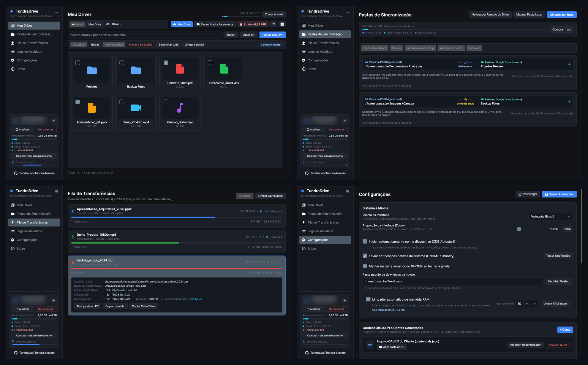

# TundraDrive

[-16A34A?style=for-the-badge&logo=linux)](https://github.com/TundraLab/TundraDrive/releases/latest)

> **Este repositório funciona apenas como redirecionamento e vitrine de portfólio.**
>
> O código-fonte atualizado, o guia de instalação e os downloads oficiais estão no repositório da organização:
> 👉 **[github.com/TundraLab/TundraDrive](https://github.com/TundraLab/TundraDrive)**

---

## Sobre o TundraDrive

O **TundraDrive** é um aplicativo nativo para Linux que conecta seu computador ao Google Drive, permitindo sincronizar pastas, fazer backups automáticos e gerenciar arquivos na nuvem com uma interface moderna.

- **Sincronização flexível:** escolha por pasta entre manter tudo igual nos dois lados (PC e Drive) ou enviar apenas do computador para a nuvem como backup.
- **Gerenciador visual de arquivos:** explore seu Google Drive, pré-visualize fotos, vídeos, áudios e documentos direto no aplicativo, faça ações em lote e gerencie a Lixeira.
- **Múltiplas contas Google:** conecte diferentes contas no mesmo lugar com visualização clara do armazenamento de cada perfil.
- **Integrado ao desktop Linux:** roda na bandeja do sistema, inicia com o computador quando desejado e exibe notificações nativas no GNOME, COSMIC e KDE Plasma.
- **Instalação e atualização simples:** distribuído em **`.AppImage`** e **`.rpm`**, com instalador guiado e verificador automático de novas versões dentro do próprio aplicativo.

## Autoria

Projeto idealizado e desenvolvido integralmente por **Gustavo Henrique Novaes Gomes** ([`@GustaHerin`](https://github.com/GustaHerin)) na **TundraLab**.

- **Repositório oficial:** [TundraLab/TundraDrive](https://github.com/TundraLab/TundraDrive)
- **Download da última versão:** [Releases do TundraDrive](https://github.com/TundraLab/TundraDrive/releases/latest)

## Licença

Copyright © 2026 **TundraLab** e **Gustavo Henrique Novaes Gomes** ([`@GustaHerin`](https://github.com/GustaHerin)). Todos os direitos reservados.
Consulte os termos completos em [LICENSE](LICENSE).
